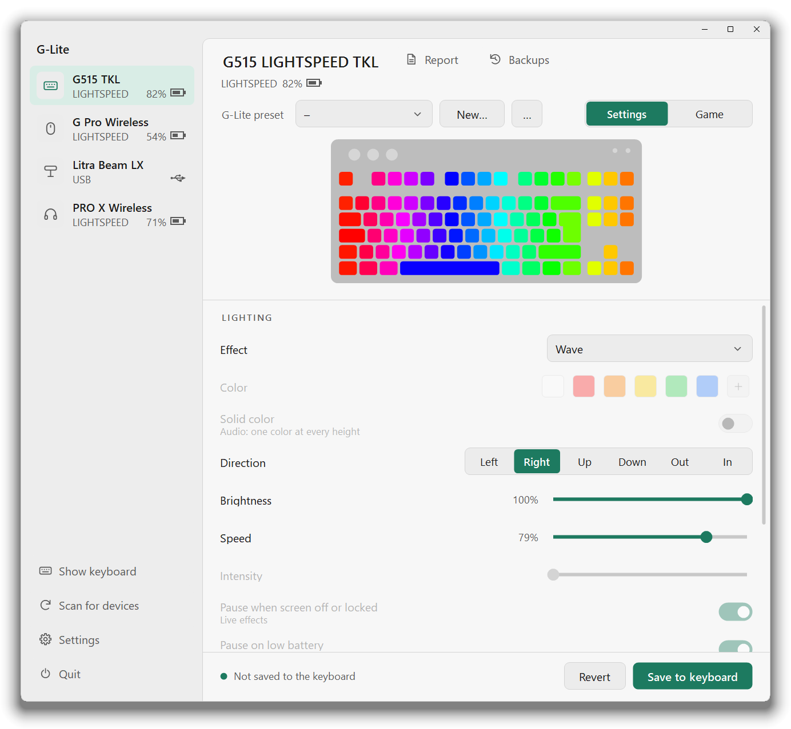

# G-Lite

A small Windows app that controls the lighting, DPI and other settings of Logitech G keyboards, mice, headsets and lights, without G HUB. One file, nothing to install, and next to no CPU when idle. It can also stop G HUB and Logitech Gaming Software, so they don't undo your settings, and start them again.

> [!WARNING]
> **G-Lite is experimental.** It writes to your device's onboard memory, and a bug could leave a device in a bad state or brick it. It never touches the factory profile, checks every write and backs up what's on a device before each save, but it has only been tested on a few devices. Use it at your own risk.

<picture>
  <source media="(prefers-color-scheme: dark)" srcset="docs/screenshot-dark.png">
  
</picture>

## How to use

You need Windows 10 (version 1903 or later) or Windows 11.

1. Quit G HUB, and stop it from starting with Windows. Both apps control the same devices and would undo each other's changes. G-Lite's Settings can do it for you: Services lists G HUB, Logitech Gaming Software and the LampArray service, with Stop and Start.
2. On Windows 11, turn off **Dynamic Lighting** (Settings > Personalization > Dynamic Lighting), for the same reason. G-Lite warns you if it's on.
3. Download `GLite.exe` from the [latest release](https://github.com/csmarvz/g-lite/releases/latest) and double-click it.
4. G-Lite finds your Logitech G devices and lists them on the left. Click one to change its settings.
5. Click **Save to keyboard** or **Save to mouse** to keep your changes on the device.
6. To go back to the factory settings, or to an earlier save, use **Backups** at the top of a keyboard or mouse screen.

If Windows says it protected your PC, click **More info**, then **Run anyway**. G-Lite isn't signed yet. To check that your copy is the one GitHub built, run `Get-FileHash GLite.exe` in PowerShell and compare the result with `checksums.txt` on the release page.

**How long your changes last.** The line at the bottom of each screen tells you. There are three cases:

- **Saved to the device** (the G515 and mice, with **Save to keyboard** or **Save to mouse**): stays on the device, even without G-Lite or on another PC.
- **Set on the device, not saved** (the G915, G915 TKL and G815 until you save, the G213, G413, G512 X 75, G510 and the other keyboards G-Lite can't save to, the G560, the Litra colours): stays until the device sleeps or turns off. G-Lite sets it again when it starts.
- **Run by G-Lite** (the effects marked Live: Screen, and on keyboards with per-key lighting Starlight, Echo, Audio, Rain, Fire and Aurora; Audio on the older keyboards; the G510's Breathe and Cycle; the Litra's Breathe, Cycle and Wave): keeps going while G-Lite runs, in the tray too, and stops if you quit it.

The preset you picked on each device is picked again when G-Lite starts, and set on the device if it no longer has it, like a G515 or mouse whose preset wasn't saved to it.

## Supported devices

### Keyboards

| Device | Connection | Status | What G-Lite can do |
|---|---|---|---|
| G915 TKL | LIGHTSPEED receiver | Works | Lighting effects, colour, speed, direction, brightness, the Screen effect, idle dimming and turn-off, profiles, and saving to the keyboard's onboard profile, with backups. Experimental, not tried yet: F1–F12 (its G keys) set to a key, a media key, a mouse click or nothing, and the keys Game mode turns off. See [docs/G815-G915.md](docs/G815-G915.md). |
| G213 | USB | Works | Off, Static, Breathe, Cycle and Wave on the whole keyboard, Off and Static on each of its five areas, with colour, speed, direction and brightness, a live key picture, and profiles. The keyboard can't store lighting (G HUB can't either), so G-Lite sets it again at each start. See [docs/G213.md](docs/G213.md). |
| G815 | USB | Works | Lighting effects, colour, speed, direction, its five brightness levels, the Screen effect, profiles, and saving to the keyboard's onboard profiles, with backups. M1–M3 switch the profile from G-Lite and are followed when pressed, as is the brightness key. G1–G5 can be set to a key, a media key, a mouse click or nothing, and the factory profile restored. Pick the keys the Game mode key turns off. See [docs/G815-G915.md](docs/G815-G915.md). |
| G413 | USB | Works | Off, Static and Breathe with brightness (one colour: G-Lite's brightness works within the keyboard's own level, Fn+F7), speed and profiles, an Audio effect (the lighting follows the PC's sound), a live key picture, and the Game mode keys. The keyboard's lighting is set again at each start. See [docs/G413.md](docs/G413.md). |
| G515 LIGHTSPEED TKL | LIGHTSPEED receiver | Works | Lighting effects, colour, speed, direction, brightness, idle dimming and turn-off, profiles, saving to the keyboard, backups and restoring them, factory lighting, and the keys Game mode turns off (Windows and Menu too, if you pick them) |
| G512 X 75 | USB | Partial | Lighting effects, colour, speed, direction, brightness, the Screen effect, the live effects and profiles, on the keys and the light bar, together or each with its own effect. Experimental: the keys Game mode turns off. Not yet: saving to the keyboard, the knobs and actuation. See [docs/G512X.md](docs/G512X.md). |
| G512, G513, G PRO keyboard, G810, G910, G410 and other older G keyboards | USB | Untested | Off, Static, Breathe and Cycle with colour, speed and brightness, on all zones or each one (keys, logo), and profiles. An Audio effect (the lighting follows the PC's sound). A key picture on the G512, G513, G PRO keyboard, G810, G910 and G410, and with it, experimental: G-Lite's live effects drawn key by key (Starlight, Echo, Audio, Rain, Fire, Aurora) where the keyboard has per-key colours, and the keys Game mode turns off where it has Game mode. Wave where the keyboard lists it. Not saved to the keyboard. Not yet: per-key colours of your own. See [docs/keyboards-8070.md](docs/keyboards-8070.md). |
| G915 | LIGHTSPEED receiver | Untested | The same as the G915 TKL, with G1–G5 in place of F1–F12 for the bindings. |
| G915 X, G713, G715, PRO X TKL, PRO X 60, G515 RAPID TKL, G512 X 98 and other newer G keyboards | LIGHTSPEED receiver or USB | Untested | Lighting effects, colour, speed, direction, brightness, the Screen effect and profiles. Not saved to the keyboard. The key picture is picked from the keyboard's name (TKL, 60%, 75%, full size) and may not match, except on the G915 X and G915 X TKL, which have their own (G1–G9, the media keys, the logo); picking their Game mode keys is experimental. See [docs/G915X.md](docs/G915X.md). |
| G510 and G510s | USB | Untested | Backlight Off, Static, Breathe and Cycle, with colour, brightness and speed, and profiles, on a picture of the keyboard. M1–M3 each have their own lighting: pick one in G-Lite and its M key lights. Bindings for G1–G18 in each M set, kept but not acted on yet, and the Game mode switch's state. Breathe and Cycle are run by G-Lite, so they stop when it quits. Not saved to the keyboard. Not yet: acting on the keyboard's own M and G key presses, and the LCD. See [docs/G510.md](docs/G510.md). |

### Mice

| Device | Connection | Status | What G-Lite can do |
|---|---|---|---|
| G305 LIGHTSPEED | LIGHTSPEED receiver | Works | DPI and DPI stage, lighting of the status light, report rate, profiles, saving to the mouse (the first save adds a profile next to the factory one), backups and restoring them, factory profile |
| G Pro Wireless | LIGHTSPEED receiver | Works | DPI and DPI stage, logo lighting, report rate, profiles, saving to the mouse, backups and restoring them, factory profile |
| G9x Laser Mouse | USB | Works | DPI and DPI stage, colour (Off and Static), report rate, profiles, saving to the mouse, backups and restoring them. See [docs/G9x.md](docs/G9x.md). |
| G502 LIGHTSPEED | LIGHTSPEED receiver | Partial | DPI and DPI stage, lighting (both zones get the same effect), report rate, profiles, saving to the mouse, backups and restoring them, factory profile, invert scrolling, what each button does. Not yet: macros and the G-shift layer. |
| G502 HERO, G303 and G502 Proteus Spectrum | USB | Untested | DPI and DPI stage, lighting, report rate, profiles, saving to the mouse, backups and restoring them, factory profile, what each button does. Built from the protocol notes of libratbag, Solaar and g502-hub. |
| PRO X SUPERLIGHT 2, PRO X 2 DEX, PRO X 2, G502 X and other newer G mice | LIGHTSPEED receiver or USB | Untested | DPI, switching between the DPI stages saved on the mouse, the report rate up to 8000 Hz, and the buttons. On the SUPERLIGHT 2, the DEX and other mice with profile format 6, 7 or 8: saving the DPI stages, report rate and buttons to the mouse, with backups, and restoring the factory profile. Some of these mice only accept their saved DPI stages. See [docs/newer-mice.md](docs/newer-mice.md). |
| PRO X SUPERLIGHT (the first one, which calls itself PRO X Wireless) | LIGHTSPEED receiver or USB | Untested | DPI and DPI stage, report rate, profiles, saving to the mouse, backups and restoring them, factory profile, what each button does. Its lighting record is kept as it is. Built from GFlick and onboard-lite, which saved to this mouse. See [docs/newer-mice.md](docs/newer-mice.md#format-4-the-original-pro-x-superlight). |
| G502 X PLUS | LIGHTSPEED receiver or USB | Untested | DPI and DPI stage, report rate, profiles, saving to the mouse, backups and restoring them, factory profile, what each button does. No lighting yet: it lights through 0x8071, and its lighting records are kept as they are. Saving needs the firmware with profile format 5: after a firmware update that moves it to format 10, G-Lite only reads it. Built from OMM's profile layouts and GOMM. See [docs/newer-mice.md](docs/newer-mice.md#format-5-the-g502-x-plus). |
| G300, G300s | USB | Untested | The active profile's DPI levels (250 to 2500), report rate, colour (eight) and buttons, saved to the mouse with backups. Nothing changes until you save. Built from PeriHub, which saved on a G300. See [docs/G300.md](docs/G300.md). |
| G600 | USB | Untested | Read only: the active mode's DPI levels, report rate, lighting and 20 buttons. See [docs/G600.md](docs/G600.md). |
| G500 and G500s | USB | Untested | DPI and DPI stage (up to 8200 on the G500s), report rate, profiles, saving to the mouse, backups and restoring them. They save like the G9x. See [docs/G9x.md](docs/G9x.md). |
| G5, G9, G700 and G700s | USB | Untested | DPI (from the G5's four settings, the G9's 200–3200, or 200–5700 / 8200 on the G700 and G700s) and report rate, set while G-Lite runs, and profiles. Not saved to the mouse. The G700 and G700s on their cable or through their receiver. See [docs/G9x.md](docs/G9x.md). |

### Headsets

| Device | Connection | Status | What G-Lite can do |
|---|---|---|---|
| PRO X Wireless | Its own LIGHTSPEED receiver | Works | Sidetone, turning off when idle, battery, profiles. Equalizer: experimental. |
| G735, PRO X 2 LIGHTSPEED, G522, A50 X and other G headsets | USB | Report only | Listed in the sidebar so their owner can send a report. Nothing can be changed yet. |

### Speakers

| Device | Connection | Status | What G-Lite can do |
|---|---|---|---|
| G560 Gaming Speaker | USB | Untested | Lighting effects, colour, speed, brightness and profiles, on all four zones or each one (bottom left, bottom right, top left, top right), on a picture of the speakers, and the Screen effect. Not saved to the speaker. Not yet: the audio visualizer effect, the equalizer. See [docs/G560.md](docs/G560.md). |

### Lights

| Device | Connection | Status | What G-Lite can do |
|---|---|---|---|
| Litra Beam LX, Beam and Glow | USB | Untested | Front light on and off, brightness and colour temperature. On the Beam LX, the back light: on and off, brightness, Static, Breathe, Cycle, Wave and the Screen effect, with a colour for all seven zones or each one, and a live picture of the light. Profiles. See [docs/Litra.md](docs/Litra.md). |

**Works** means tried on the real device. **Partial** means tried on the real device, with some of its features not done yet. **Untested** means built from documentation and owners' reports, and not yet confirmed by an owner. Devices that aren't saved to are set again by G-Lite each time it starts.

### Other Logitech devices

| Device | Connection | Status | What G-Lite can do |
|---|---|---|---|
| MX Master, MX Anywhere, MX Keys, MX Mechanical, MX Creative Keypad and other Logitech devices | Bolt or Unifying receiver, or USB | Untested | Pointer speed, SmartShift, inverted scrolling, the thumb wheel's direction, the backlight, brightness, and switching computers (Easy-Switch), when the device has them. G-Lite sets your changes again when the device comes back. Buttons, gestures and per-app settings stay in Logi Options+. See [docs/other-devices.md](docs/other-devices.md). |

Logitech devices with none of these settings show up in the sidebar with their connection, battery and firmware. Devices that could come next are listed in [#11](https://github.com/csmarvz/g-lite/issues/11).

## FAQ

**Can I use G-Lite and G HUB at the same time?**
Not well. Both control the same devices, so each would undo the other's changes. Stop G HUB while you use G-Lite: **Settings**, **Services** does it for you.

**Do I need to uninstall G HUB or Logitech Gaming Software?**
No. In **Settings**, **Services** lists G HUB, Logitech Gaming Software and the Logitech LampArray Service (which hands Logitech devices to Windows Dynamic Lighting), and shows which are running. **Stop** ends their apps, stops their Windows services and keeps them from starting with Windows; Windows asks for administrator rights once per click. **Start** puts everything back, and so can Task Manager (Startup apps) and Services, even without G-Lite. G HUB still opens if you start it yourself. See [docs/services.md](docs/services.md).

**What happens to my settings if I stop using G-Lite?**
Whatever you saved to a keyboard or mouse stays on it, and works without any app. Settings that aren't saved to the device (the keyboards G-Lite can't save to, the G560, the Litra) go back to the device's own when it restarts.

**What if a save goes wrong?**
G-Lite backs up what's on the device before every save and reads back everything it writes. If a save stops halfway, the device's screen offers to restore the backup. You can also restore any backup, or the factory profile, from **Backups**.

**Does it work with my device?**
Open G-Lite: if your device is listed with a screen of settings, yes. If it shows only its info, click **Report** and send the report in an issue, and it may be added.

## Get help

Open an [issue](https://github.com/csmarvz/g-lite/issues). Say what you did and what happened, and add the device's report (**Report** on its screen) and the lines from **Logs** around that time.

## Your files

G-Lite has no installer. Everything it keeps is in plain text files you can open, copy or delete:

- **`settings.txt`**, next to `GLite.exe`: your presets and the one picked on each device, the lighting it sets again on each start, and your choices in Settings. If that folder can't be written to, it goes in `%LOCALAPPDATA%\GLite` instead.
- **`log.txt`**, next to `settings.txt`: what G-Lite did and when, like the devices it found, what it sent to them and updates. **Logs** in the sidebar shows it. When it reaches 512 KB, it becomes `log.old.txt` and a new one starts.
- **Backups**, in `%LOCALAPPDATA%\GLite\backups`: a copy of what was on your keyboard or mouse before each save, one folder per device. G-Lite keeps the first one and the last ten. **Backups** on a device's screen restores them.

To remove G-Lite, quit it from the tray, turn off **Run on startup** in Settings, and delete these files.

## Privacy

G-Lite never sends your data or how you use it anywhere. There are no accounts, no analytics and no tracking.

- A device report stays on your PC. It only leaves when you copy it and paste it somewhere yourself. **Open GitHub issue** opens a new issue in your browser with the report filled in, and nothing is sent until you submit it.
- The only time G-Lite goes online is to check GitHub for a new version when it starts, and to download one. You can turn that off in Settings.

## Project status

Beta. The devices marked Works have been tried on real hardware; everything else needs owners to try it and send a report. What changed in each version is in the [changelog](CHANGELOG.md).

## Contributing

Reports from device owners help the most, and need no code. To build G-Lite, add a device or send a pull request, see [CONTRIBUTING.md](CONTRIBUTING.md).

## Credits

- [logirgb](https://github.com/mevdschee/logirgb) by Maurits van der Schee. The G515 feature set the app copies, and the protocol notes and hardware logs in its `research` folder, including copies of Logitech's HID++ 2.0 feature documents (0x8040, 0x8070, 0x8071).
- [logirgb: Logitech G515 and G502 RGB on Linux](https://www.tqdev.com/2026-logirgb-logitech-g515-g502-rgb-linux/), the article introducing logirgb.
- [logitech-g515-onboard](https://github.com/federico-duppa/logitech-g515-onboard) by Federico De Malmayne Duppa. The onboard profile and file layout (0x8100/0x8101) used to make the lighting persist on the keyboard.
- [Solaar](https://github.com/pwr-Solaar/Solaar), [OpenRGB](https://github.com/CalcProgrammer1/OpenRGB) and [libratbag](https://github.com/libratbag/libratbag). Facts about the G915 (its ids, features, lighting clusters and effect parameters), receivers (Bolt pairing, how a HID++ 1.0 device answers, the G700's receiver and wireless ids) and onboard mouse profiles. No code is taken from them. See [docs/G815-G915.md](docs/G815-G915.md).
- Logitech's HID++ 2.0 feature specifications, shared publicly in the "hidpp20 public" folder linked from cvuchener's hidpp. Lighting (0x8070, 0x8071, 0x8081, 0x8040), DPI and report rate (0x2202, 0x8061), the wheel (0x2121, 0x2110), backlight (0x1982), Easy-Switch (0x1814, 0x1815), the Litra (0x1990) and the headset (0x8300, 0x8310). Facts only.
- [hidpp](https://github.com/cvuchener/hidpp) and [g500](https://github.com/cvuchener/g500) (GPL-3.0) by Clément Vuchener. The HID++ 1.0 mice: the G9x, G500, G500s, G700, G700s, G9 and G5's DPI units, profile layouts, memory and write rules. Facts only, no code. See [docs/G9x.md](docs/G9x.md).
- [g502-hub](https://github.com/Ahmedxsaad/g502-hub) (GPL-3.0). The G502 HERO: profile format 2, its factory button bindings and button slots. Facts only, no code.
- [litra-rs](https://github.com/timrogers/litra-rs) (MIT) by Tim Rogers. The Litra lights' commands and ids. See [docs/Litra.md](docs/Litra.md).
- The Linux kernel's HID drivers (`hid-lg`, `xpad`, `hid-ids.h`) and the "hid: Support for Litra Glow" patch (GPL-2.0), and [SDL_GameControllerDB](https://github.com/gabomdq/SDL_GameControllerDB). Gamepad ids and names, and the Litra's events. Facts only. See [docs/gamepads.md](docs/gamepads.md).
- [Lghub](https://github.com/HolyJoey/Lghub) (MIT), G HUB reverse-engineered for Linux. How G HUB talks to Logitech G headsets, mice, keyboards and other devices, over USB, LIGHTSPEED, Unifying, Bolt and Bluetooth. G HUB's key-to-LED table for the G915's logo, G keys and media keys comes from it.
- [logi-cli](https://github.com/meech-io/logi-cli) (MIT) by Dimitri Brooks and [OpenLogi](https://github.com/AprilNEA/OpenLogi). The newer mice: 0x2202 DPI, 0x8061 report rate and where the DPI stages sit in their onboard profile.
- [Featherweight](https://github.com/Ad1FPS/Featherweight) (MIT) and [logitech-onboard-memory](https://github.com/marco-vrinssen/logitech-onboard-memory) (MIT). Profile format 7 and how to write it, on a PRO X SUPERLIGHT 2 and a PRO X 2 DEX.
- [GFlick](https://github.com/R4ULtv/gflick) (MIT) by Raul Carini and [onboard-lite](https://github.com/ZhichenJin/onboard-lite) (MIT). Profile format 4 on the original PRO X SUPERLIGHT, written and read back on the mouse.
- libratbag's G600 driver and [g600prog](https://github.com/tulth/g600prog) (MIT). The G600's feature reports.
- [PeriHub](https://github.com/hex-dump/perihub) (MIT). The G300's profile reports and how to save them, tried on an owner's G300; and many HID++ facts (`docs/research/more-references.md`).
- [G-Helper](https://github.com/seerge/g-helper), the model for the look and feel of the tray panel.

## License

MIT. See [LICENSE](LICENSE).

G-Lite isn't made, endorsed or supported by Logitech. Logitech, Logitech G, G HUB, LIGHTSPEED and Litra are trademarks of Logitech.
