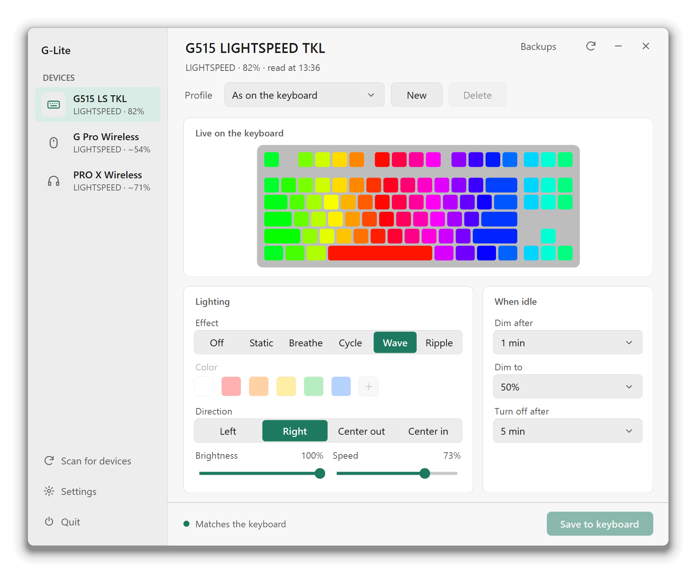

# G-Lite
Lightweight G Hub alternative.

> [!WARNING]
> **G-Lite is experimental.** It writes to your device's onboard memory, and a bug could leave a device in a bad state or brick it. It never touches the factory profile, checks every write and backs up what's on a device before each save, but it has only been tested on one keyboard, one mouse and one headset. Use it at your own risk.

<picture>
  <source media="(prefers-color-scheme: dark)" srcset="docs/screenshot-dark.png">
  
</picture>

## How to use

1. Download `GLite.exe` from the [latest release](https://github.com/csmarvz/g-lite/releases/latest).
2. Double-click `GLite.exe`.
3. G-Lite finds your Logitech G devices and lists them on the left. Click one to change its settings.
4. Click **Save to keyboard** or **Save to mouse** to keep your changes on the device.
5. To go back to the factory settings, or to an earlier save, use **Backups** at the top of a keyboard or mouse screen.

If Windows says it protected your PC, click **More info**, then **Run anyway**. G-Lite isn't signed yet.

## Supported devices

| Device | Connection | What G-Lite can do |
|---|---|---|
| G515 LIGHTSPEED TKL | LIGHTSPEED receiver | Lighting effects, colour, speed, direction, brightness, idle dimming and turn-off, profiles, saving to the keyboard, backups and restoring them, factory lighting |
| G Pro Wireless | LIGHTSPEED receiver | DPI and DPI stage, logo lighting, report rate, profiles, saving to the mouse, backups and restoring them, factory profile |
| G305 LIGHTSPEED | LIGHTSPEED receiver | DPI and DPI stage, lighting of the status light, report rate, profiles, saving to the mouse (the first save adds a profile next to the factory one), backups and restoring them, factory profile |
| G502 LIGHTSPEED | LIGHTSPEED receiver | Partial. DPI and DPI stage, lighting (both zones get the same effect), report rate, profiles, saving to the mouse, backups and restoring them, factory profile, invert scrolling, what each button does. Not yet: macros and the G-shift layer. |
| PRO X Wireless | Its own LIGHTSPEED receiver | Sidetone, turning off when idle, battery, profiles |
| G512 X 75 | USB | Untested. Lighting effects, colour, speed, direction, brightness and profiles, live only, on the keys and the light bar, together or each with its own effect. The key picture isn't checked on a real keyboard yet. Not yet: saving to the keyboard, the knobs and actuation. See [docs/G512X.md](docs/G512X.md). |
| G560 Gaming Speaker | USB | Untested. Lighting effects, colour, speed, brightness and profiles, live only, on all four zones or each one. Not yet: zone names, the audio visualizer effect, the equalizer. See [docs/G560.md](docs/G560.md). |
| Litra Beam LX, Beam and Glow | USB | Untested. Front light on and off, brightness and colour temperature. On the Beam LX, the back light: on and off, brightness, Static, Breathe, Cycle and Wave (run by G-Lite, so they stop when it closes) with a colour for all seven zones or each one, and the Screen effect. Profiles. Live only. See [docs/Litra.md](docs/Litra.md). |
| G512, G513, G PRO keyboard, G810, G910, G410, G413 and G213 | USB | Untested. Any G keyboard with 0x8070 lighting and no 0x8071. Off, Static, Breathe and Cycle with colour, speed and brightness, on all zones or each one (keys, logo), and profiles. Live only. Not yet: Wave, per-key colours, a key picture, saving to the keyboard. See [docs/keyboards-8070.md](docs/keyboards-8070.md). |
| G915, G915 TKL and G815 | LIGHTSPEED receiver or USB | Untested. Lighting effects, colour, speed, direction, brightness and profiles, live only. G-Lite sets your lighting again when it starts and when you open the keyboard, but can't save it to the keyboard yet. |

Other G mice and headsets with the same features get the same screens, but they haven't been tested. Other Logitech devices show up in the sidebar with their connection, battery and firmware, but G-Lite can't change their settings yet. Devices that could come next are listed in [#11](https://github.com/csmarvz/g-lite/issues/11). To help add yours, open it in G-Lite, click **Report** and send the report in a new issue.

## References

- [logirgb](https://github.com/mevdschee/logirgb) by Maurits van der Schee. The G515 feature set the app copies, and the protocol notes and hardware logs in its `research` folder, including copies of Logitech's HID++ 2.0 feature documents (0x8040, 0x8070, 0x8071).
- [logirgb: Logitech G515 and G502 RGB on Linux](https://www.tqdev.com/2026-logirgb-logitech-g515-g502-rgb-linux/), the article introducing logirgb.
- [logitech-g515-onboard](https://github.com/federico-duppa/logitech-g515-onboard) by Federico De Malmayne Duppa. The onboard profile and file layout (0x8100/0x8101) used to make the lighting persist on the keyboard.
- [Solaar](https://github.com/pwr-Solaar/Solaar), [OpenRGB](https://github.com/CalcProgrammer1/OpenRGB) and [libratbag](https://github.com/libratbag/libratbag). Facts about the G915: its ids, features, lighting clusters and effect parameters. No code is taken from them. See [docs/G915.md](docs/G915.md).
- [Lghub](https://github.com/HolyJoey/Lghub) (MIT), G HUB reverse-engineered for Linux. How G HUB talks to Logitech G headsets, mice, keyboards and other devices, over USB, LIGHTSPEED, Unifying, Bolt and Bluetooth. G HUB's key-to-LED table for the G915's logo, G keys and media keys comes from it.
- [G-Helper](https://github.com/seerge/g-helper), the model for the look and feel of the tray panel.
